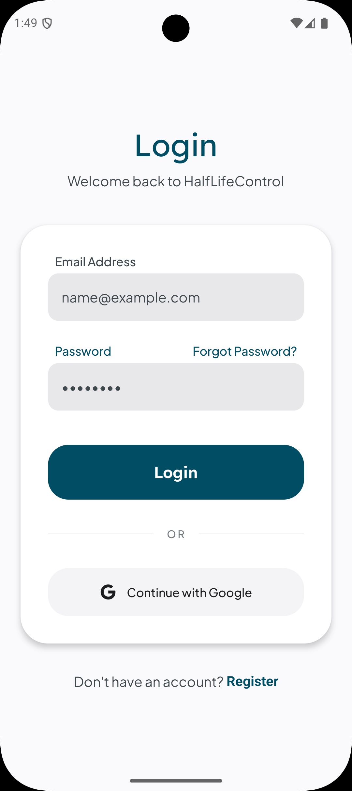
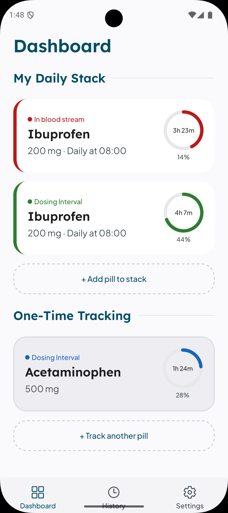
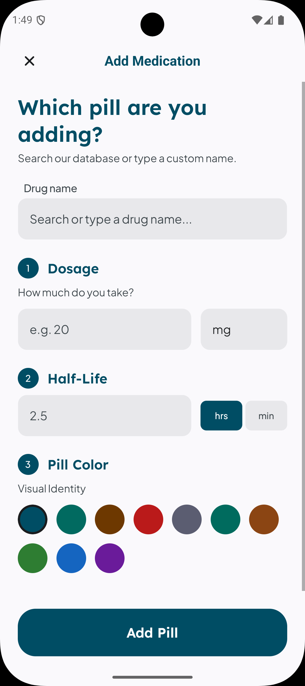
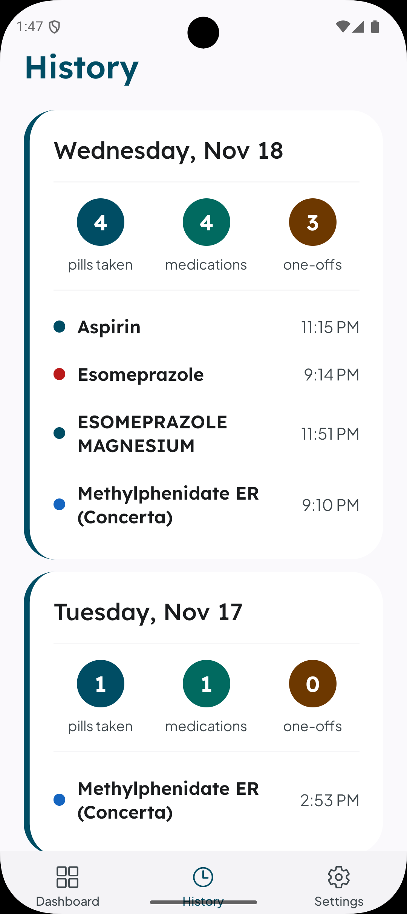
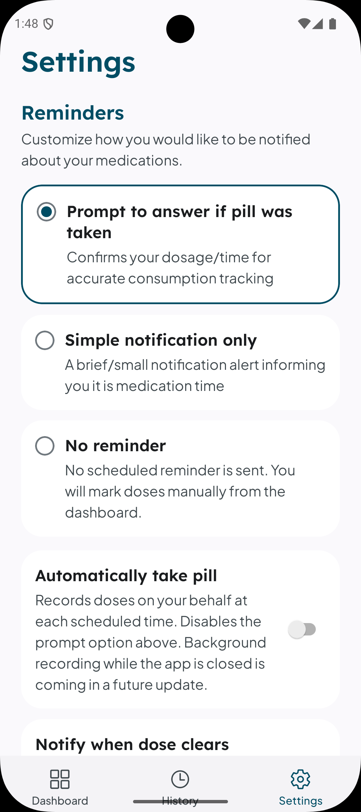

# HalfLifeControl

A mobile app that tracks how long a medication stays active in your body. You build a "pill stack" with your daily schedule, log each dose, and the app shows live countdowns based on the drug's half-life, how long it keeps working, and when it has cleared your system.

I built this as a portfolio project to show two things: that I can take a mobile app from an idea to a working product with a real backend, and how I work with AI coding agents to get there.

> **Medical disclaimer**
>
> HalfLifeControl is **not a medical device and is not intended for public use.** I don't promote it as a health product, and nothing it shows should ever be taken as professional medical advice. The countdowns come from general half-life formulas and typical reference values. Real absorption and elimination depend on age, weight, liver and kidney function, other medications and many other factors the app cannot know. Never start, stop, skip or change a dose based on this app. Always follow your doctor or pharmacist.
>
> This is also the main reason the app was never published on Google Play or the App Store. Releasing a medication app responsibly would mean meeting medical and regulatory review, validating every drug value, and being certain nobody could be harmed by misreading a timer. That was out of scope for a portfolio project, so it stays a fully working demo.

## Screenshots

<table>
  <tr>
    <td width="20%" align="center"></td>
    <td width="20%" align="center"></td>
    <td width="20%" align="center"></td>
    <td width="20%" align="center"></td>
    <td width="20%" align="center"></td>
  </tr>
  <tr>
    <td align="center"><sub>Login</sub></td>
    <td align="center"><sub>Dashboard</sub></td>
    <td align="center"><sub>Add pill</sub></td>
    <td align="center"><sub>History</sub></td>
    <td align="center"><sub>Settings</sub></td>
  </tr>
</table>

## What it does

- **Pill stack with schedules.** Daily, specific weekdays, or every N days, each with a reminder time. Schedules can be edited later without corrupting past history.
- **One-time tracking.** Log a pill you took outside your routine and watch it count down until it clears, then it removes itself.
- **Three timers per dose.** Time left in the bloodstream, the current half-life window, and either the duration of action or the dosing interval, depending on the drug.
- **Drug search.** A curated database of about 150 drugs with half-life and duration data, plus a fallback search against the FDA's public openFDA database for anything else.
- **Reminders.** Local notifications with "took it" and snooze actions, grouped when several pills are due at the same time, and an optional "assume taken" mode.
- **History.** Doses grouped by day, with counts of pills taken, distinct medications and one-off doses.
- **Accounts.** Email and password, Google sign-in, password reset through a deep link, and in-app account deletion that removes all data from the server.
- **Freemium model.** Free users get one scheduled pill and four one-time trackers. Pro unlocks the rest through monthly, annual or lifetime plans. Purchases run in RevenueCat's test environment, so no real money is involved.

## Tech stack

| Area | Tools |
|---|---|
| App | React Native 0.83, Expo SDK 55 (dev client), TypeScript, Expo Router, Zustand |
| Backend | Supabase: Postgres with Row Level Security, Auth, Edge Functions (Deno) |
| Payments | RevenueCat (entitlements, webhook to the backend) |
| Monitoring | Sentry |
| Notifications | expo-notifications |
| Data sources | DailyMed (FDA drug labels), PubChem, openFDA |
| Testing | Jest (jest-expo) |

## Platform status

HalfLifeControl was designed from the start to run on both Android and iOS, and the code is written once with that in mind. **In its current state it runs on Android only.** That's where it was built, tested and verified.

The iOS version hasn't been built or tested yet. The app's JavaScript already bundles for iOS, but running it there still needs the native iOS project, a Mac to build and sign it, Apple's in-app purchase setup and Sign in with Apple. I set those aside to finish the Android version first.

## Engineering highlights

A few parts I'm proud of and that are worth a look if you're reviewing the code:

- **Offline first.** Every change is applied locally right away and recorded in a write-ahead log, then synced to Supabase in order. If the server permanently rejects a write, it is dropped so it can't block later syncs. Writes that failed because the phone was offline stay queued. See `src/services/supabase/pills.ts`.
- **Encrypted local data.** Medication data cached on the device is encrypted with AES-256-GCM, and auth tokens live in the platform's secure storage (`src/services/secureStorage.ts`).
- **The server enforces the rules, not just the UI.** Row Level Security isolates every account. A database trigger enforces the free plan limit, and the subscription tier column can only be written by the RevenueCat webhook (migrations `0005` and `0006` in `supabase/migrations`).
- **Scheduling math that holds up.** Schedules are computed in local calendar days, so they stay correct across daylight saving changes. "Every N days" cycles are anchored to a start date, and editing a schedule doesn't cause the auto-assume feature to backfill fake doses. Covered by tests in `src/core/__tests__`.
- **A sourced drug database.** Scripts in `scripts/` pull FDA label sections and PubChem data. Each drug was then classified by how its third timer should behave, with the reasoning documented in `docs/DRUGS.md`.
- **A backend migration.** The first version ran on Firebase. I moved it to Supabase partway through to get a relational model, SQL constraints and simpler server-side rules. The history is in the commit log.

## How this was built: working with AI agents

This app is the result of a collaboration between me and Claude (Anthropic's AI model, used through Claude Code). I want to be clear about how that worked, because the way I directed the work is as much a part of this portfolio as the code itself.

**My role**

- I wrote the product vision and requirements (`docs/GAMEPLAN.md` starts with my original brief) and broke the work into phases.
- I made every final architecture and product decision. That includes moving from Firebase to Supabase, the offline-first design, the freemium limits, making the Lifetime plan non-refundable, and deciding not to publish.
- I kept the agents in context across many sessions through living documents: a progress log (`docs/APPPROGRESS.md`) and a list of tasks only a human could do, such as dashboard settings, keys and store accounts (`docs/DEVELOPERINPUT.md`).
- I reviewed the code the AI produced, tested every feature on the Android emulator, and corrected the AI when it was wrong. For example, it once told me to change a Java setting the project had already configured. I pushed back, it checked, and it withdrew the claim. My own testing also caught real bugs that automated tests missed, like history not refreshing after taking a dose and a database constraint failing for drugs found through the FDA search.

**The AI's role**

- Claude implemented most of the code under my direction, proposed options with tradeoffs when I asked, and ran typechecks, unit tests and builds before handing work back.
- Several Claude models were used over the life of the project. The co-author trailers in the commit history show which ones.

**Design**

The visual design system (colors, typography, spacing and screen layouts) started from mockups I made with Google Stitch. Those mockups are kept in `docs/` and were translated into the React Native components.

The takeaway I'd offer a recruiter: I can ship with AI agents without handing over judgment. I set the direction, keep the context straight, verify the output and own the decisions.

## Project structure

```
src/
  app/          Screens and navigation (Expo Router, file based)
  components/   Shared UI and pill components
  core/         Pure logic: half-life math, scheduling, parsing (unit tested)
  services/     Supabase, cache and sync, notifications, RevenueCat, Sentry, openFDA
  stores/       Zustand state
  data/         Curated drug database
supabase/
  migrations/   Database schema, RLS policies, triggers
  functions/    Edge Functions (RevenueCat webhook, account deletion)
scripts/        Drug database build scripts
docs/           Plan, progress log, setup notes, research, screenshots
```

## Running it locally

The app needs its own backend, so it won't run straight from a clone. You would need:

1. A Supabase project with the migrations in `supabase/migrations` applied and both Edge Functions deployed.
2. A `.env` file based on `.env.example` (Supabase URL and anon key, plus optional RevenueCat and Sentry keys).
3. An Android emulator or device. Expo Go is not supported because the app uses native modules.

```bash
npm install
npx expo run:android            # first build, installs the dev client
npx expo start --dev-client     # later runs
npx jest                        # unit tests
```

More detail is in `docs/SETUP_GUIDE.md` and `docs/DEVELOPERINPUT.md`.

## License

Copyright (c) 2026 Fernando González Ruiz. **All rights reserved.**

This repository is public only so it can be viewed as part of my portfolio. No permission is granted to copy, modify, distribute or use any part of it without my written consent. See [LICENSE](LICENSE).
